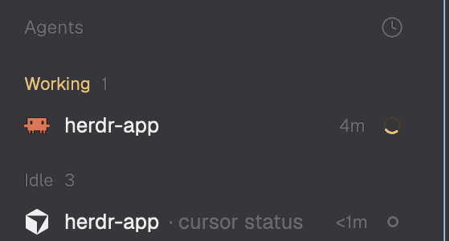

# Cursor Status

Terminals running Cursor Agent CLI (`cursor-agent`) show up in Herdr's
Agents panel with Cursor's name and icon, and their status follows the
agent: working while it thinks or runs tools, done when it finishes while
you're looking elsewhere, idle when it waits for your next prompt. Nothing
new appears on screen; the existing Agents list, tab and space status dots
start covering Cursor.

## What you see

No region of its own: the mod renders an empty `div` and is placed nowhere
(`place: "none"`). What changes is Herdr's own UI: a `cursor-agent` terminal
gets a row in the Agents list (shipped `agents` mod) and counts toward its
tab's and space's status, using the `cursor` entry of Herdr's programs table
(name "Cursor", `icons/cursor.svg`).

## How it behaves

- Session starts: **idle**.
- You submit a prompt, and after every tool call: **working**.
- The turn ends: **idle**; Herdr turns it into **done** if you weren't
  looking at that terminal, and back to idle once you do. A turn Cursor
  reports as failed (`stop` with `status: "error"`) is **error**, which
  Herdr shows like blocked.
- The session ends: the report is cleared and the terminal is no longer an
  agent.
- **blocked** never happens: Cursor has no hook for "waiting for your
  approval" that doesn't also decide the approval.
- No clicks, keys or hovers; nothing moves.
- Outside Herdr (no `HC_TERMINAL_ID`) it does nothing.

## Built from

- `mods/cursor-status/mod.json`: `{ "place": "none", "title": "Cursor Status" }`.
- `mods/cursor-status/main.js`: a `View` whose `render` returns
  `div().id("cursor-status")`. No `herdr` functions, no commands.
- `mods/cursor-status/status.mjs` (Node 20+, no dependencies), run by Cursor
  from `~/.cursor/hooks.json`, not by Herdr:
  - `hook <event>`: reads the JSON payload on stdin (gives up after 1s),
    maps `sessionStart` → `idle`, `beforeSubmitPrompt`/`postToolUse` →
    `working`, `stop` → `idle` (`error` if `status === "error"`),
    `sessionEnd` → `clear`, and writes
    `\x1b]7501;state=<state>:app=cursor\x1b\\` to `/dev/tty`. If `/dev/tty`
    can't be opened it walks up to 6 ancestors with
    `ps -o tty=,ppid= -p <pid>` and writes to the first tty that opens.
    Prints nothing, always exits 0.
  - `install`: adds `{ "command": "node '<abs path>/status.mjs' hook <event>", "timeout": 5 }`
    to each event's list, after existing entries; replaces an older entry
    of its own (matched by `cursor-status/status.mjs' hook`); backs the
    original up once to `hooks.json.cursor-status-backup`; writes
    atomically, through symlinks, keeping permissions.
  - `uninstall`: removes only its entries (and empty event lists).
  - `doctor`: JSON `{ installed, hooksFile, events, app, script, inHerdr }`.
- Programs run: `node` (by Cursor), `ps` (only when `/dev/tty` fails).

## Watch out

- The report must go to the terminal, not stdout: Cursor reads the hook's
  stdout as its response.
- Never hook `preToolUse`, `beforeShellExecution`, `beforeMCPExecution`,
  `beforeReadFile`, `beforeTabFileRead` or `subagentStart`: they take a
  permission decision. `beforeSubmitPrompt` takes `continue`; empty output
  leaves it alone, as other tools' hooks there already rely on.
- `app=cursor` is the key of Herdr's `cursor` program; `cursor-agent` (its
  `match`) also works. Anything else shows as a generic agent.
- Don't print `done` yourself: Herdr derives it from working → idle.
- Keep the person's other hooks (other tools install into the same file),
  and refuse to rewrite a `hooks.json` that isn't valid JSON.
- Cursor reads hooks when `cursor-agent` starts; running sessions need a
  restart.
- Assumes `node` on the `PATH` Cursor gives its hooks, and macOS or Linux.

## Done when

- `herdr-app check mods/cursor-status` passes.
- `node --test` passes: exact OSC bytes per event, empty stdout for every
  event, no write without `HC_TERMINAL_ID`, an unopenable tty tolerated,
  install idempotent with foreign hooks kept and one backup, uninstall
  removing only its own entries, malformed `hooks.json` refused.
- After `install`, a new `cursor-agent` in a Herdr terminal appears in the
  Agents panel as Cursor, turns working on a prompt and done/idle when it
  finishes; `hc get` on its terminal shows `"app": "cursor"`.
- After `uninstall`, `~/.cursor/hooks.json` equals its state before install.
